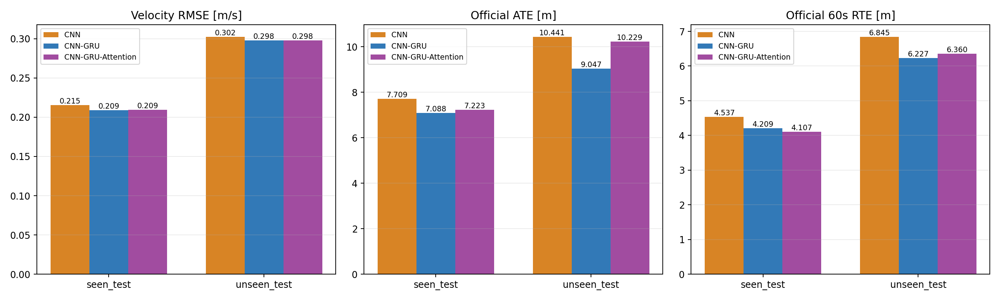

# Neural Inertial Odometry: CNN, GRU, Attention and Rotation Consistency

《工程大数据》课程小组项目：使用 RoNIN 预处理 IMU 数据估计窗口平均水平速度，通过速度积分重建行走轨迹，比较 CNN、CNN-GRU、CNN-GRU-Attention，并探索水平旋转集成、旋转增强和一致性约束。

这是基于现有代码和已完成实验整理的项目快照。RoNIN ResNet18 是参考网络；本项目的 NPZ 适配、标签协议与实验划分需要单独说明，结果不能直接称为达到 RoNIN 原论文指标。

**发布范围：代码、固定划分、指标与汇总图表。数据集、训练权重及完整逐窗口预测不随仓库发布。**

## 快速导航

- [数据格式与标签](docs/DATA.md)
- [运行与复现实验](docs/REPRODUCE.md)
- [实验目录索引](docs/EXPERIMENTS.md)
- [整理范围与完整性](manifests/packaging_summary.json)
- [GitHub 上传说明](docs/GITHUB.md)
- [上游来源与许可证](THIRD_PARTY_NOTICES.md)

## 技术路线

```text
152 条预处理 NPZ + 固定序列名单
  → features[start:start+200] → [B, 6, 200]
  → CNN / CNN-GRU / CNN-GRU-Attention
  → 输入窗口的平均 [vx, vy]，单位 m/s
  → 沿时间积分并插值重建 XY 轨迹
  → 速度 MSE / RMSE / MAE，轨迹 ATE / 60s RTE
```

网络预测的是**当前输入窗口的平均水平速度**，不是“下一秒的位置”。监督标签为：

```text
end = start + 200
y = (positions[end, :2] - positions[start, :2])
    / (timestamps[end] - timestamps[start])
```

`positions` 来自上游参考轨迹，用于生成标签和评估；NPZ `targets` 为相邻帧位置差分速度，当前加载器仅用它筛选训练异常窗口。两者都不作为网络输入。输入六通道依次是角速度 XYZ 和加速度 XYZ。详见 [数据说明](docs/DATA.md)。

### 三种模型

| 路线 | 时间特征汇总方式 | 输出 |
|---|---|---|
| CNN | 三层 1D 卷积、两次池化，最后全局平均池化 | `[B,2]` |
| CNN-GRU | 相同卷积结构得到 50 个时间步，单层 GRU，取最终隐藏状态 | `[B,2]` |
| CNN-GRU-Attention | 对全部 GRU 隐状态计算加性注意力，再加权汇总 | `[B,2]` |

CNN 到 CNN-GRU 同时改变模型容量和回归头输入维度，应称为结构对照。CNN-GRU 到 Attention 保持卷积骨干、GRU 和回归头结构相同，是时间汇总方式的直接消融。所有模型按独立窗口工作，GRU 不在相邻窗口之间传递状态。

## 已完成的结果

下表摘自已保存的[九路线完整测试表](reports/cnn_gru_yaw_equivariance_20261027/comparison/test_metrics.csv)。RMSE 单位 m/s，ATE 单位 m，均为越低越好。seen / unseen 分别含 35 / 32 条完整测试序列。

| 路线 | Seen RMSE | Unseen RMSE | Seen ATE | Unseen ATE |
|---|---:|---:|---:|---:|
| RoNIN ResNet18，项目固定协议 | 0.1886 | 0.2736 | 5.4684 | 9.8951 |
| CNN | 0.2153 | 0.3025 | 7.7088 | 10.4411 |
| CNN-GRU，单次推理 | 0.2089 | 0.2977 | 7.0882 | 9.0468 |
| CNN-GRU-Attention | 0.2092 | 0.2979 | 7.2226 | 10.2286 |
| 原 CNN-GRU + C4 推理 | 0.1862 | 0.2712 | 5.2162 | 7.1837 |
| A：旋转增强训练，单次推理 | 0.1869 | 0.2659 | 5.4653 | 8.7785 |
| B：增强 + 一致性损失，单次推理 | 0.1871 | 0.2629 | 6.4979 | 7.8611 |
| A：旋转增强训练 + C4 | 0.1705 | 0.2431 | 4.6942 | 6.0391 |
| B：增强 + 一致性损失 + C4 | 0.1718 | 0.2435 | 4.7427 | 6.1075 |

实验结论需要区分参考对象：

- CNN-GRU 相对 CNN 的 seen / unseen ATE 分别下降 **8.05% / 13.35%**；加入 Attention 后，MAE 继续下降，但 ATE 相对 CNN-GRU 分别上升 **1.90% / 13.06%**，没有实现逐模块单调提升。
- 对同一冻结 CNN-GRU 做 C4 四方向逆旋转平均，seen / unseen ATE 分别下降 **26.41% / 20.59%**，代价约为四次模型前向。
- 旋转增强训练有收益，但 B 相对 A 的单次推理 ATE 在 seen 退化、unseen 改善。一致性损失没有达到预设的两套测试集整体改善条件。不能把增强和 C4 的收益全部归于一致性损失。

基础三路线各训练 30 轮，seed 42，Adam、lr=1e-4、batch=256、窗口平均速度 MSE，按验证 MSE 选权重。增强训练对每个原窗口额外处理一个旋转副本，计算预算不同；C4 也增加推理开销。以上是已测单种子、重复使用测试集的探索性结果，不构成统计显著性或独立盲测结论，也不代表长期漂移已经消失。

完整五项指标、逐序列变化、失败案例和协议见 [reports](reports/README.md)。



## 目录

```text
.
├── cnn_baseline/                 # 模型、统一加载器、训练、评估及诊断
├── scripts/                      # RoNIN ResNet18 的 NPZ 适配与结果整理
├── ronin-master/                 # 移交的上游源码，保留原 LICENSE
├── RoNIN_Team_Delivery/
│   ├── dataset/                  # 本地：152 条正式 NPZ，不进入普通 Git
│   ├── splits/                   # train / val / seen_test / unseen_test
│   ├── quality_report/           # 上游数据质量记录
│   └── ...                       # 上游加载器、技术说明与库存表
├── results/                      # 本地完整实验档案，不进入普通 Git
├── reports/                      # 适合随代码提交的指标、配置、报告与汇总图
├── docs/                         # 数据、复现、实验索引、上传说明
├── environment/                  # 实际环境记录及精确版本清单
├── manifests/                    # 复制文件、数据及实验索引与 SHA256
├── tools/check_package.py        # 只读检查目录、数据结构和模型接口
├── requirements.txt
└── .gitignore
```

**本地完整目录**包含数据、权重、完整预测、日志和逐轨迹图；**普通 GitHub 克隆**只包含代码、固定划分、元数据与精简报告。恢复数据或完整结果时必须保持上述相对路径。详细位置与校验清单见 [上传说明](docs/GITHUB.md)。

## 环境与快速检查

已记录环境：Python **3.11.16**、PyTorch **2.14.0+cu126**、NumPy **1.23.5**、SciPy **1.10.1**、Matplotlib **3.7.2**，训练 GPU 为 RTX 4060 Laptop、CUDA 12.6。原始记录在 [environment](environment/README.md)。

在项目根目录运行：

```bash
python -m pip install -r requirements.txt
python -B tools/check_package.py
python -B tools/check_package.py --models
```

以上基础与模型接口检查不需要数据。恢复152条NPZ后，再执行`python -B tools/check_package.py --data`检查数据结构。

此处给出安装方法，不意味着所有平台/版本组合均已测试。`requirements.txt` 对 PyTorch 使用功能最低版本，精确训练版本另行保留。CUDA 训练需可用的 CUDA 版 PyTorch；普通模型接口检查使用 CPU。

### 独立训练和速度评估

```bash
python -B cnn_baseline/train.py --model cnn_gru --epochs 30 --no-early-stopping --out results/my_cnn_gru
python -B cnn_baseline/evaluate.py --checkpoint results/my_cnn_gru/checkpoint_best.pt --out results/my_cnn_gru_velocity_eval
```

`--model` 支持 `cnn`、`cnn_gru`、`cnn_gru_attention`。此通用评估入口计算速度指标，不计算 ATE/RTE。严格对齐已归档三路线实验时，应按 [复现说明](docs/REPRODUCE.md) 使用固定协议入口，而不是将通用入口结果直接混入历史对照。

训练和评估大多拒绝覆盖已有输出目录。每次重跑使用新目录；已保存的历史配置、日志与 checkpoint 可能记录旧机器的绝对路径，这些是保留的溯源记录，并非新机器的运行路径配置。

## 数据与来源边界

固定划分为 **72 train / 13 val / 35 seen_test / 32 unseen_test**，序列文件互不重叠。seen 测试允许受试者在训练侧出现，unseen 为未见受试者。上游质量报告中的 85 条 train 指划出验证集前的物理 train 目录，不等于当前训练名单。

该快照从已处理 NPZ 开始，不提供原始 HDF5 到 NPZ 的完整生成脚本。上游 `08_ronin_dataset.py` 是数据加载器，不应误认为原始数据转换程序。数据再分发许可需要在公开数据之前确认，默认不把 NPZ 或模型权重提交到 Git。

## 许可证与致谢

本项目新增代码以 **GNU GPL v3（SPDX: GPL-3.0-only）** 发布，完整条款见根目录 [LICENSE](LICENSE)。保留的 RoNIN 源码继续遵守其 [原始许可证](ronin-master/LICENSE)，原有版权和来源说明均保留。各贡献者保留各自新增内容的版权，详见 [第三方声明](THIRD_PARTY_NOTICES.md) 和 [NOTICE](NOTICE.md)。上游项目信息和论文链接见 [RoNIN README](ronin-master/README.md)。代码授权不等于数据或训练权重的再分发授权；本仓库不包含这些文件。
